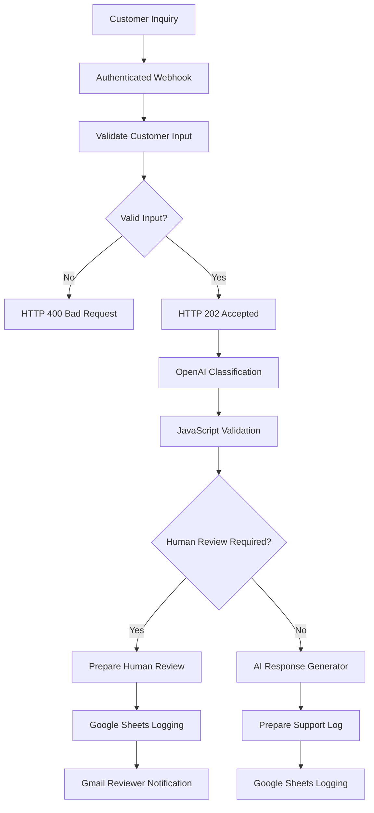

# JayEx AI Customer Support Automation

An AI-powered customer support workflow that classifies incoming inquiries, generates response drafts, escalates sensitive requests for human review, and records interactions for tracking and evaluation.

Built with **n8n, OpenAI, JavaScript, REST APIs, Google Sheets, Gmail, and PowerShell**.

## Project Overview

Customer support teams often spend time sorting repetitive inquiries, preparing responses, and identifying issues requiring human attention.

I built JayEx AI Customer Support Automation to demonstrate how AI and workflow automation can streamline these processes while maintaining human oversight.

The system accepts customer inquiries through an authenticated webhook, uses an LLM to classify the request, and routes it through the appropriate workflow.

**This is a portfolio demonstration using fictional customer information and a demo business. It has not been deployed for a paying client.**

## Key Features

- **AI Classification:** Categorizes incoming messages as general information, appointments, billing, or other.
- **AI Response Drafting:** Creates responses without automatically sending them to customers.
- **Human-in-the-Loop:** Escalates billing disputes and flagged inquiries.
- **Input Validation:** Rejects invalid submissions before AI processing.
- **Webhook Security:** Uses HTTP Header Authentication.
- **HTTP Responses:** Returns 202 for accepted inquiries and 400 for invalid submissions.
- **Google Sheets Integration:** Records customer inquiries and AI outputs.
- **Gmail Notifications:** Alerts reviewers about escalated inquiries.
- **Error Monitoring:** Sends notifications when workflow executions fail.
- **Automated Evaluation:** Tests classification and escalation decisions using PowerShell.

## Technology Stack

| Technology           | Purpose                                                 |
| -------------------- | ------------------------------------------------------- |
| n8n                  | Workflow orchestration                                  |
| OpenAI GPT-4o-mini   | Inquiry classification and response generation          |
| JavaScript           | Input validation, parsing, and workflow data processing |
| REST APIs / Webhooks | Receiving external customer inquiries                   |
| Google Sheets        | Logging inquiries and AI outputs                        |
| Gmail                | Human-review notifications                              |
| PowerShell           | Automated API tests and AI evaluation                   |
| CSV                  | Test results and evaluation reports                     |

## System Architecture



A separate n8n error-handling workflow monitors execution failures and sends notification emails.

## AI Classification and Escalation

The AI classifies inquiries into four categories:

| Category            | Example                        |
| ------------------- | ------------------------------ |
| general_information | What are your business hours?  |
| appointment         | Can I schedule an appointment? |
| billing             | I was charged twice.           |
| other               | I need help with an issue.     |

The JavaScript validation node checks whether the AI returns the expected JSON structure.

If parsing or validation fails, the request is flagged for human review.

Billing classifications and AI-reported confidence scores below 0.80 also trigger mandatory human review.

The confidence score is generated by the language model and is not a calibrated probability of correctness.

## API Behavior

The workflow receives JSON requests containing customer information.

### Example Request

```json
{
  "customerName": "Alex Johnson",
  "email": "alex@example.com",
  "message": "What are your business hours?",
  "testId": "optional-test-identifier"
}
```

The `testId` field is optional and supports evaluation tracking.

### Accepted Request

HTTP status: `202 Accepted`

```json
{
  "success": true,
  "message": "Customer inquiry accepted for processing."
}
```

### Invalid Request

HTTP status: `400 Bad Request`

```json
{
  "success": false,
  "errors": ["A valid email address is required."]
}
```

The webhook acknowledges valid requests before downstream AI processing finishes. Therefore, HTTP 202 does not guarantee successful classification or logging.

Unauthorized requests are rejected by n8n's Header Authentication.

## Automated Testing

I built PowerShell scripts to submit test inquiries and evaluate the resulting workflow decisions.

Testing covers:

- Valid HTTP requests
- Missing email addresses
- Invalid email formats
- Business-hours questions
- Appointment requests
- Billing disputes
- Customer complaints
- Unclear inquiries
- A prompt-injection attempt

### Evaluation Results

| Metric                                 | Observed result        |
| -------------------------------------- | ---------------------- |
| API validation tests                   | 3/3 passed             |
| AI classification and escalation tests | 6/6 passed             |
| AI evaluation pass rate                | 100% on six test cases |
| Error notification simulation          | Passed                 |

The six AI evaluation scenarios measured category classification and human-review routing. These results do not establish production-wide AI accuracy or general prompt-injection resistance.

Each evaluation request includes a unique test ID that links expected outcomes to the actual Google Sheets results.

The scoring script compares the expected category and human-review decision against the recorded outputs, then generates an evaluation report.

## Error Monitoring

The main automation uses a separate n8n Error Trigger workflow for execution-failure notifications.

To validate the monitoring process, I created a controlled failure simulation using a Webhook and Stop And Error node.

The simulation confirmed that n8n recorded the failure and the error handler automatically delivered an email alert.

The error handler provides monitoring and notification; it does not currently implement automatic retries or recovery.

## Installation and Setup

1. Import `workflows/jayex-customer-support-public.json` into n8n.
2. Configure your own Header Authentication credential.
3. Connect an OpenAI-compatible credential supported by your n8n instance.
4. Create a Google spreadsheet with the required logging columns.
5. Configure both Google Sheets nodes with your document and worksheet.
6. Connect your Gmail credential and replace the demo review email.
7. Configure your own business information in the AI Response Generator.
8. Optionally create and attach a separate error-monitoring workflow.
9. Test the workflow before publishing.

The public workflow intentionally excludes private credentials, spreadsheet identifiers, and deployment-specific settings.

## Running the Tests

The test scripts are designed for PowerShell 7.

```powershell
pwsh -NoProfile -File .\test-webhook.ps1
```

Run the AI evaluation submissions:

```powershell
pwsh -NoProfile -File .\test-ai-evaluation.ps1
```

The scripts must be configured with your own webhook URL and authentication key.

Export the Google Sheets results as `actual-results.csv`, then generate an evaluation report:

```powershell
pwsh -NoProfile -File .\score-ai-evaluation.ps1
```

## Current Limitations

- The workflow uses a demo business and fictional customer data.
- Responses are drafts and are not automatically sent to customers.
- Model-reported confidence is not independently calibrated.
- Google Sheets is used as a lightweight logging system.
- Evaluation currently covers a small set of test scenarios.
- The error handler sends alerts but does not automatically recover failed executions.
- Production use would require broader testing, stronger privacy controls, and operational monitoring.

## Future Improvements

- Expand automated evaluation datasets.
- Add retry and recovery strategies for external API failures.
- Move business information into a maintainable knowledge source.
- Develop a dashboard for support and automation metrics.
- Add an authenticated reviewer approval workflow.
- Improve observability and reporting.

## Project Status

**Functional portfolio prototype — tested using fictional customer scenarios.**

Developed as an independent AI Automation Engineering project under JayEX.
